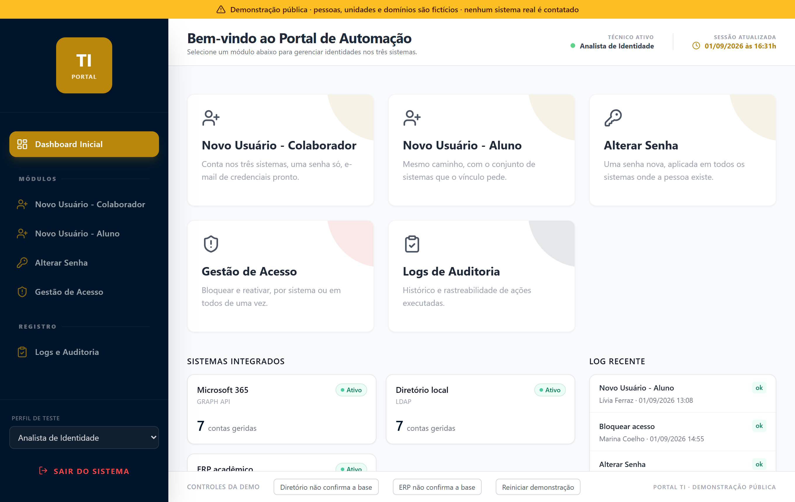
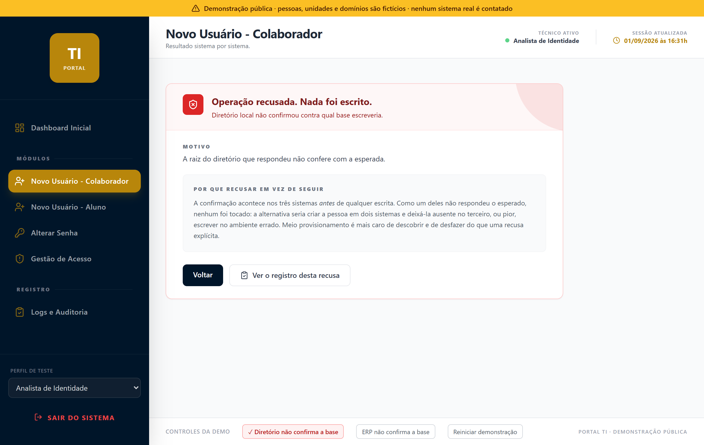
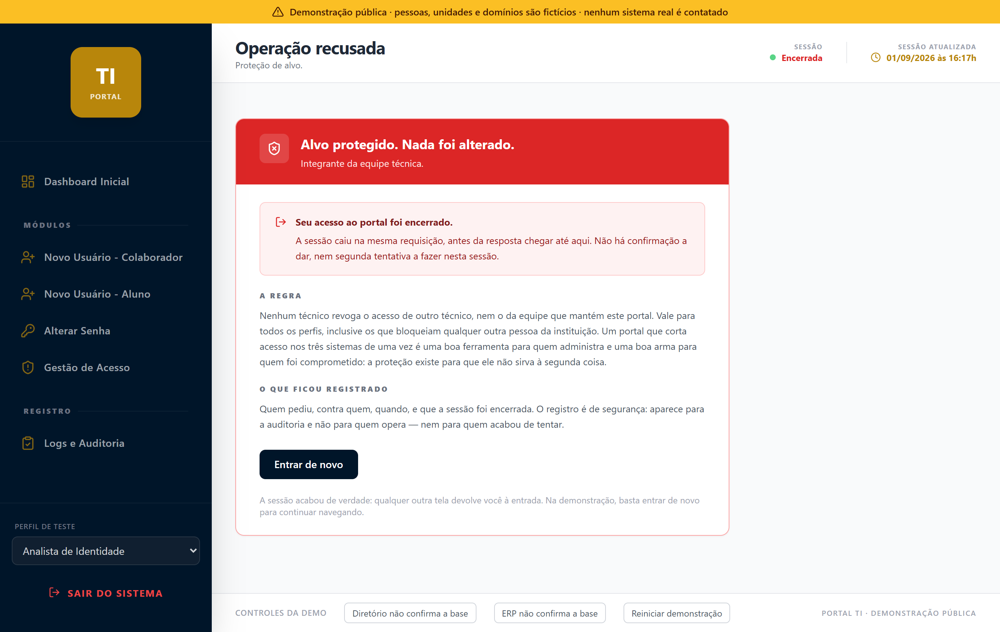
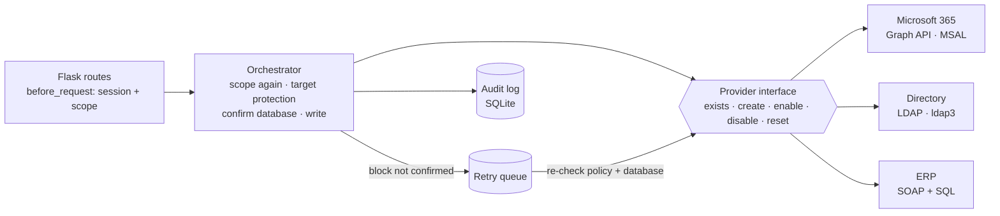

# Portal TI: identity provisioning across Microsoft 365, a directory and an ERP (public demo)

> 🇧🇷 [Versão em português](README.pt-BR.md)
>
> **Live demo: https://gualmeidap.github.io/portal-ti-o365-demo/** (English and Portuguese, toggle at the top). It runs **entirely in your browser**: the same Flask app in this repository is loaded into [Pyodide](https://pyodide.org) (CPython compiled to WebAssembly), so there is no server, no cold start, and nothing you do leaves your machine.

An internal identity-management portal I built from scratch for a university's IT team. One action creates, resets or blocks a person's access in three systems at once: **Microsoft 365**, the **on-premises directory** and the **academic/financial ERP**. It replaced a manual process where each system was handled separately, by different people, with credentials delivered in different ways.

**This repository is a showcase.** The production portal is private. What is here is a navigable slice with data invented from scratch and the integrations replaced by in-memory simulations behind the same provider interface. **The safety rules described below run for real in this code**: they are the subject of the demo.



---

## What makes it more than a CRUD

The value is in the safeguards, not the screens. Each one exists because of a specific way things go wrong.

### 1. Fail closed

Before writing anything, **each integration confirms which database it is about to write to**: Microsoft 365 checks the token is for the expected tenant, the directory reads the root of the open connection, the ERP runs the query that tells staging from production (same schema, same look). If a system cannot confirm, it is not written.

- **Creating and resetting are all-or-nothing.** Every database is confirmed before any is written. Confirming and writing system by system leaves a person created in two systems and missing in the third when the last one fails, and half-done provisioning costs more to find and undo than an explicit refusal.
- **Blocking does not wait for the slowest system.** Refusing a whole block because one system could not confirm would leave access open in the other two, which is exactly the risk a block exists to close. So each system that confirms is blocked at once; the one that did not is still not written, and goes to a **retry queue** (no screen, like the real portal: a scheduled job) that re-confirms the database before writing.



### 2. Target protection

No technician blocks another technician, nor the team that maintains the portal, whatever their profile. Whoever tries **loses the session in the same request and the profile stays suspended** until Audit & Security lifts it (and the lift is logged). A portal that cuts access in three systems at once is a good tool for administrators and a good weapon for a compromised account; the protection exists so it cannot serve the second purpose.

The check lives in the orchestration, not only in the route: a script or a console call hits it the same way.



### 3. Profiles with real scope

Each profile reaches a set of operations and a set of systems. Session and scope are checked in a `before_request` and **again in the orchestration**, the only path to the integrations, so a typed URL, a tampered form or an old tab all end in the same 403. Out-of-scope menu items stay visible with a lock, on purpose: hiding the button prevents mistakes, not attempts.

| Profile | Can do |
|---|---|
| Identity Analyst | Create, reset, block in all three systems; retry job runs in the background |
| Human Resources | Access Management only, all three systems; gets an **e-mailed receipt** of every offboarding |
| E-mail Operator | Microsoft 365 only |
| Service Desk (L1) | Password resets only |
| Audit & Security | Operates nothing; reads everything, including security records; lifts suspensions |

### 4. Audit as a product

One line per action with **each system's result on the same line**. Security events (protected-target attempts, scope denials, suspensions) are filtered **in the database query**, not on screen: someone who may be the subject of an investigation never receives those rows, not even their count.

### 5. One password, and an e-mail that says where it works

The username differs in each system (`name@domain`, `DOMAIN\name`, a short ERP user). One temporary password for all three, delivered in an e-mail that says, per system, which username to use. **If that e-mail is not delivered, the operation is "partial", not a success**: a password nobody was told about locks the person out.

### 6. Search across the three databases, not a pick-list

The main way technicians work is **searching for a person**, not choosing from a list of known users. In Access Management and Password Reset you pick a database (Microsoft 365 by e-mail, local directory by network login, ERP by record or name), type at least 4 characters, and get the candidates. The minimum length and the database you may search are enforced **on the server**: a profile that only reaches Microsoft 365 cannot search the directory or the ERP, even by forging the URL.

Whoever has no account in a database does not appear in it, and the person's panel then shows the other databases side by side. The seeded data includes someone who exists only in the ERP and someone only in the directory. The reset screen offers only the systems where the person has an account and the profile reaches, and shows the destination e-mail masked.

### 7. Real directories are inconsistent

- **Incomplete offboarding** (blocked in one system, still active in another) is highlighted on the dashboard and in the list. The seeded data includes such a case.
- **ERP homonyms**: when more than one ERP record matches a name, the portal does not guess. The technician picks one, and the choice is re-checked on the server against the candidates.

---

## Try it

1. As **Identity Analyst**, search `tiago` and try to block him. Then sign in as **Audit & Security** to see what was recorded and lift the suspension.
2. Search `marina`: she is blocked in Microsoft 365 only. As **Human Resources**, block her everywhere and check the receipt. Switch the database to **ERP** and search `marta`: she exists only there.
3. Turn on **ERP does not confirm its database** in the footer and block someone everywhere: the other systems are blocked immediately, the ERP stays in the retry queue. Turn the control off again ("the system is back, the job ran") and look at the Logs.
4. Search `paulo` in the ERP: two similar records, and the portal makes you choose.
5. Switch to **E-mail Operator** and go to a screen outside its scope by URL: add `#/criar-aluno` to the end of the address. The server answers 403 and logs it.
6. Toggle **PT/EN** at any point: the audit history is translated too.

## Architecture



The orchestration imports no protocol library: it walks a dict of providers and reads their results. Adding a fourth system is one file in `portal_demo/providers/`. Details in [docs/arquitetura.md](docs/arquitetura.md) (Portuguese).

**Production stack:** Flask 3, Jinja2, gunicorn · `msal` + Microsoft Graph · `ldap3` · SOAP over `requests` · `pymssql` · SQLite for audit · Tailwind via CDN, no front-end framework.

**This demo:** the same Flask app with in-memory providers. Bilingual through a PT→EN dictionary (Portuguese is the source text); a test renders every screen in English and fails on any untranslated string. For GitHub Pages, `tools/build_site.py` packages the app, its templates and the pure-Python wheels, and `web/shell.js` runs it in Pyodide, handing link clicks and form posts to Flask's own test client (same routing, guards and cookie session).

## Run and test

```bash
python -m venv .venv
# Windows: .venv\Scripts\activate    Linux/macOS: source .venv/bin/activate
pip install -r requirements-dev.txt
python app.py                  # Flask server at http://127.0.0.1:5057
pytest -q                      # scope, protection, suspension, fail-closed, queue, homonyms, e-mail, i18n
python tools/build_site.py     # the static build GitHub Pages serves
python -m http.server 8000 -d _site
```

`.github/workflows/pages.yml` runs the tests, builds the site and publishes it on every push to `main`.

Screenshots in `docs/capturas/` show the Portuguese UI and are generated by `tools/capturas.py` (headless Chrome over the same flows).

## About the data

The institution, domains, people, units, programs and identifiers were **invented from scratch for this showcase**. Nothing was copied, anonymized or blurred from a real environment. The `.example` domain is reserved by [RFC 2606](https://www.rfc-editor.org/rfc/rfc2606) for examples and never resolves.

**Not in this demo:** real network calls, the mapping of job titles to access profiles, environment configuration, and anything describing the real topology.

---

Built by [gualmeidap](https://github.com/gualmeidap)
