# Portal TI — demonstração pública

Portal interno de gestão de identidade de uma universidade. O time de TI usa
para provisionar e cortar acesso de colaboradores em três sistemas de uma vez:
**Microsoft 365**, **diretório local** e o **ERP acadêmico-financeiro**.

Substituiu um processo manual em que cada sistema era tratado separadamente,
por pessoas diferentes, com credenciais entregues de formas diferentes.

> **Este repositório é uma vitrine.** O portal em produção é privado. O que está
> aqui é um recorte navegável, com dados inventados do zero e as integrações
> substituídas por simulações em memória. As travas de segurança descritas
> abaixo, essas sim, rodam de verdade neste código — são o assunto da demo.


---

## As quatro operações

| Operação | O que faz |
|---|---|
| **Novo Usuário — Colaborador** | Conta nos três sistemas, uma senha só, e-mail de credenciais pronto para envio. |
| **Novo Usuário — Aluno** | Mesmo caminho, em outro domínio e com o conjunto de sistemas que o vínculo pede. |
| **Alterar Senha** | Uma senha nova, aplicada em todos os sistemas onde a pessoa existe. |
| **Gestão de Acesso** | Bloquear e reativar, por sistema ou em todos de uma vez. |

O fluxo de criação, do formulário ao e-mail que a pessoa recebe:

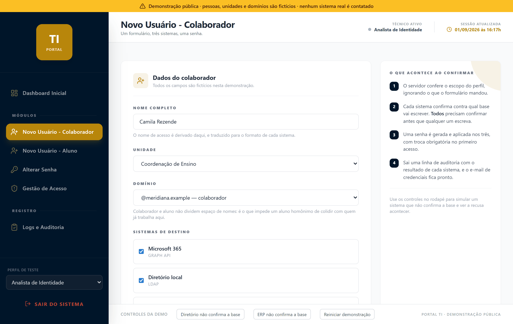

---

## O que faz este portal não ser um CRUD

O valor está nas travas, não nas telas. Cinco decisões que não se copia de um
tutorial, porque cada uma nasceu de um jeito específico de dar errado.

### 1. Falha fechada

Antes de escrever qualquer coisa, **cada integração confirma contra qual base
vai escrever**. O Microsoft 365 confere se o token vale para o ambiente
esperado; o diretório lê a raiz da conexão já aberta e compara com a
configurada; o ERP faz a consulta que distingue homologação de produção — dois
ambientes com o mesmo desenho e a mesma cara.

Se qualquer um não conseguir confirmar, a operação inteira é recusada.

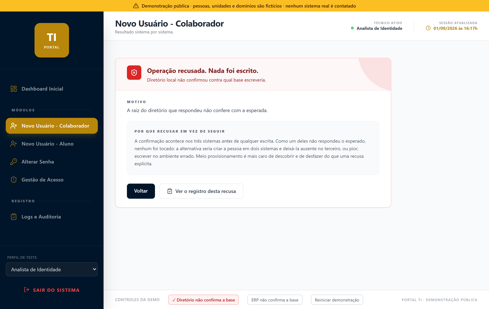

Duas coisas importam nessa ordem, e é aqui que a implementação ingênua erra:

- **Confirmar não é opcional.** Sem resposta, sem escrita. O caminho fácil é
  tratar a confirmação como um aviso e seguir mesmo assim, porque "provavelmente
  é o ambiente certo". Provavelmente não é uma garantia sobre a qual valha a
  pena escrever em três sistemas de identidade.
- **Todas as bases são confirmadas antes de qualquer uma ser escrita.**
  Confirmar sistema a sistema, escrevendo conforme avança, deixa a pessoa criada
  em dois sistemas e ausente no terceiro quando o último falha. Meio
  provisionamento é mais caro de descobrir e de desfazer do que uma recusa
  explícita — ninguém abre chamado dizendo "estou com acesso demais".

```python
# portal_demo/orquestracao.py — a ordem é a trava
for chave in sistemas:
    try:
        self.providers[chave].confirmar_base()
    except BaseNaoConfirmada as recusa:
        execucao.recusada = True          # nada foi escrito, e nada será
        return execucao

for chave in sistemas:                    # só agora se escreve
    ...
```

### 2. Proteção de alvo

Nenhum técnico bloqueia outro técnico, nem a equipe que mantém o portal. Isso
vale para **todos os perfis**, inclusive os que bloqueiam qualquer outra pessoa
da instituição. Quem tenta perde o acesso ao portal na mesma requisição.

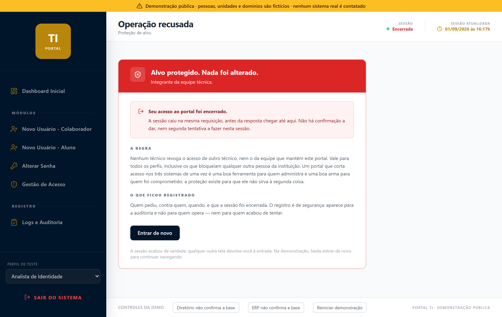

O raciocínio: um portal que corta acesso nos três sistemas de uma vez é uma
ótima ferramenta para quem administra e uma ótima arma para quem foi
comprometido. Uma conta de TI tomada, ou um técnico saindo em más condições,
tem nas mãos exatamente o botão que desliga a capacidade de resposta do resto do
time. A proteção existe para que a ferramenta não sirva a isso.

Repare no que **não** é: não é um aviso com "tem certeza?", nem um alerta que
alguém lê no dia seguinte. É recusa, encerramento da sessão e registro de
segurança — nessa ordem, na mesma requisição.

### 3. Perfis com escopo real

Cada perfil alcança um conjunto de operações e um conjunto de sistemas. Quem
opera só o e-mail não chega ao diretório nem ao ERP. A demonstração troca a
senha por uma escolha de perfil logo na entrada, porque é o escopo — e não a
credencial — que muda o que as telas seguintes deixam fazer:

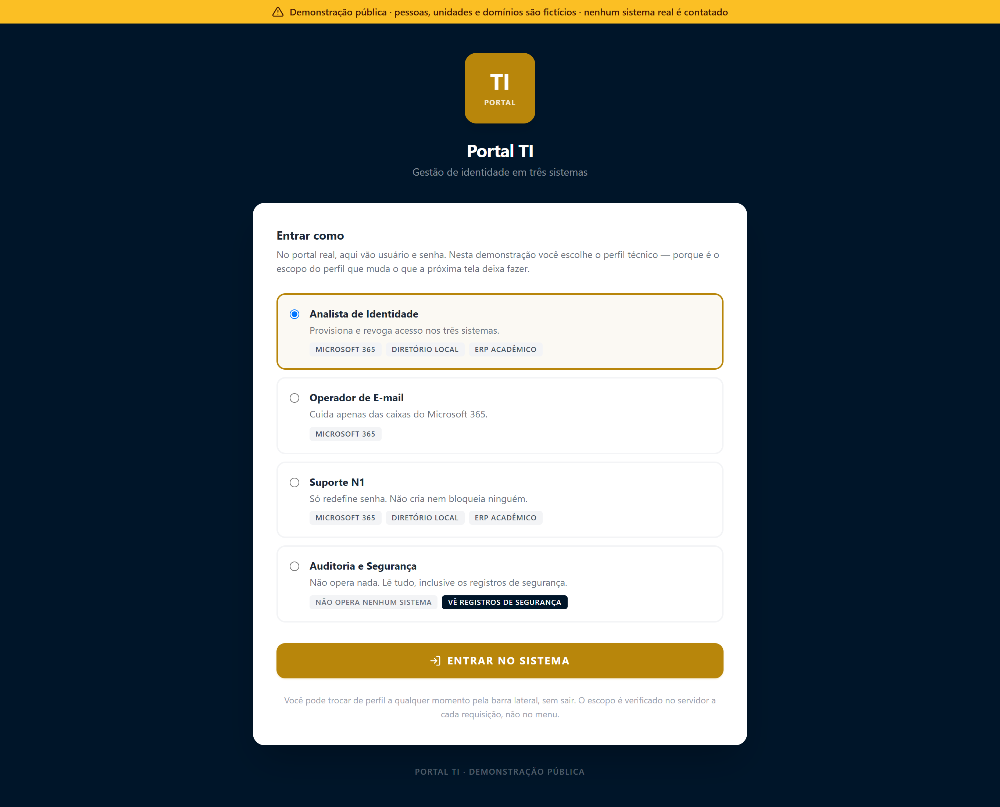

A verificação de sessão é um `before_request`: vale para todas as rotas de uma
vez, então rota nova nasce protegida por omissão e não por lembrança de quem a
escreveu.

O menu reflete isso, mas o menu é conveniência. Os itens fora do escopo
continuam visíveis, com cadeado, **de propósito**: esconder o botão resolve o
engano, não a tentativa.

| No menu | Pela URL, no servidor |
|---|---|
| 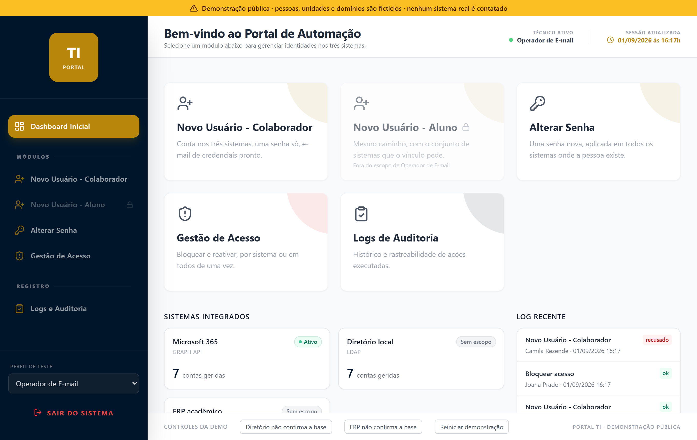 | 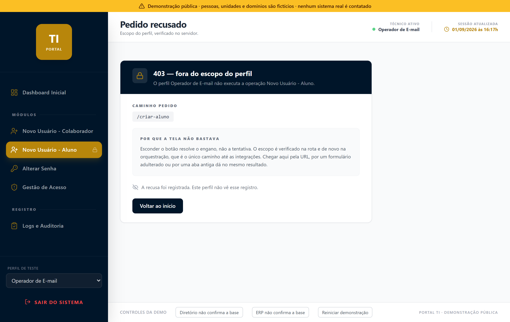 |

A verificação acontece na rota **e de novo na orquestração**, que é o único
caminho até as integrações. Requisição por URL direta, formulário adulterado ou
aba antiga dão todos no mesmo 403. A camada que decide é a mesma,
independentemente de onde o pedido veio.

### 4. Auditoria como produto

Uma linha por ação, com o resultado de **cada** sistema na mesma linha. Quem
investiga não precisa cruzar três logs para descobrir o que aconteceu — e as
recusas aparecem com o mesmo destaque dos sucessos, porque uma tentativa negada
costuma ser mais interessante que uma operação bem-sucedida.

Os eventos de segurança — tentativa contra alvo protegido, acesso negado por
escopo, sessão encerrada — **não aparecem para quem opera**, só para o perfil de
auditoria. Quem pode ser objeto de uma apuração não recebe as linhas dela.

A mesma tela, nos dois perfis, na mesma hora:

| Analista de Identidade (opera) | Auditoria e Segurança (não opera nada) |
|---|---|
| 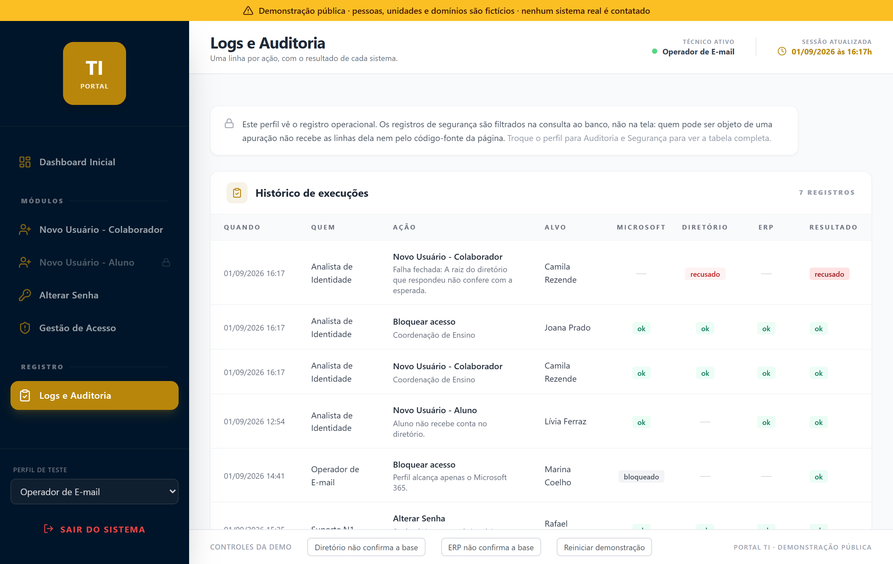 | 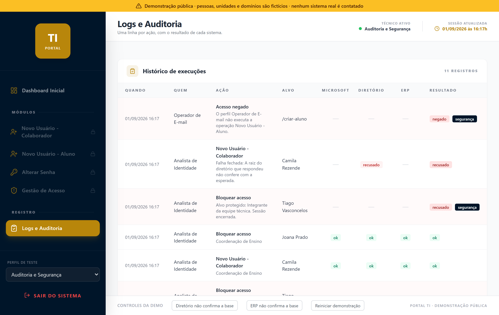 |

As linhas marcadas `segurança`, à direita, simplesmente não existem para o
perfil da esquerda.

O filtro é aplicado na consulta ao banco, não na tela:

```python
# portal_demo/auditoria.py
consulta = "SELECT * FROM eventos"
if not incluir_seguranca:
    consulta += " WHERE categoria <> 'seguranca'"
```

Uma linha que o perfil não pode ver nunca chega ao template, então não há como
vazar pelo código-fonte da página nem por um endpoint de dados. Nem a
**contagem** de eventos ocultos é exposta: um número já diria que houve o que
apurar, e quando.

### 5. Uma senha para todos os sistemas

O login não é o mesmo nos três sistemas. É `nome@dominio` no Microsoft 365,
`DOMINIO\nome` no diretório, e um usuário curto no ERP. A pessoa recebia uma
credencial, tentava o mesmo nome no segundo sistema, não entrava, e abria
chamado no primeiro dia de trabalho.

E o domínio ainda depende do vínculo: colaborador e aluno não dividem espaço de
nomes, o que impede um aluno homônimo de colidir com quem já trabalha na
instituição. São quatro formas de escrever a mesma pessoa antes de ela abrir o
computador pela primeira vez.

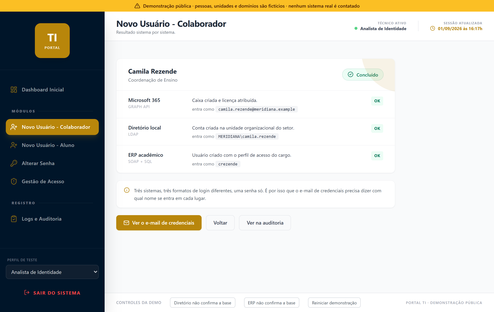

A senha passou a ser uma só para os três — decisão deliberada, porque três
senhas distintas viravam três bilhetes colados no monitor — entregue num e-mail
que diz, para cada sistema, **com qual nome se entra e para que aquilo serve**.

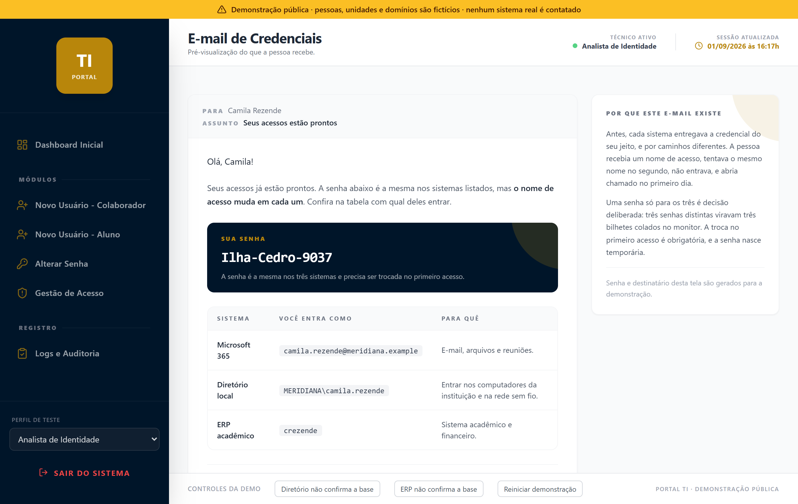

A senha nasce temporária, com troca obrigatória no primeiro acesso. E é gerada
com palavras fáceis de ditar por telefone, porque boa parte dos primeiros
acessos acontece com alguém lendo a senha em voz alta para outra pessoa.

---

## Gestão de acesso

A tela que mais se usa. Situação de cada pessoa nos três sistemas em uma linha,
e o caso do desligamento resolvido em uma ação.

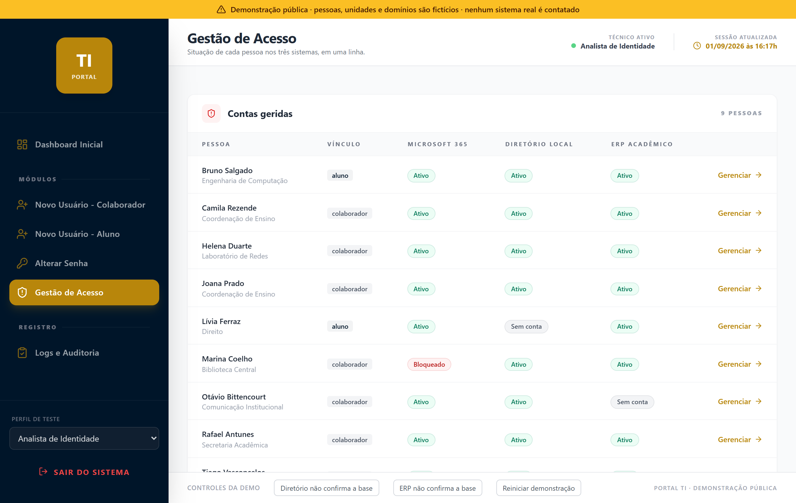

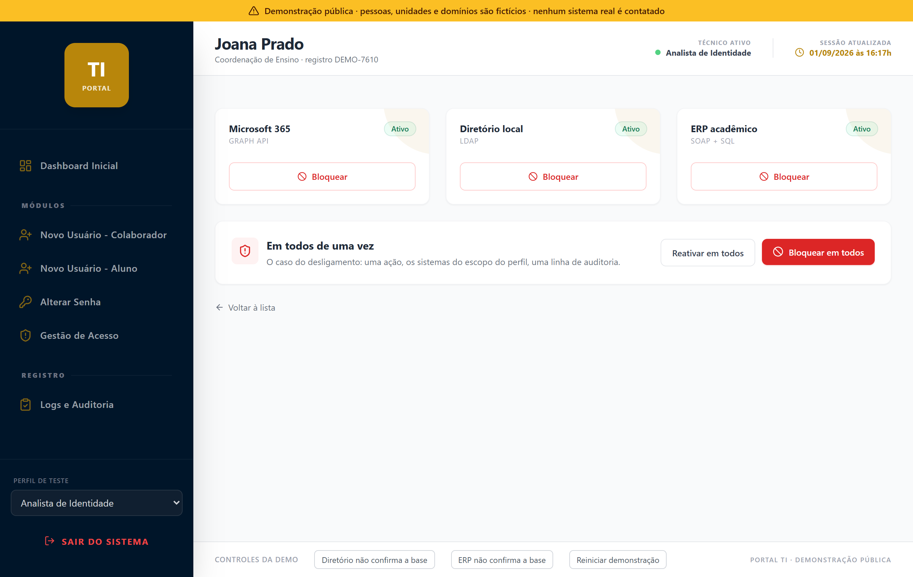

Bloquear em todos é uma operação, não três: um pedido, uma verificação de
política, uma linha de auditoria com o resultado de cada sistema.

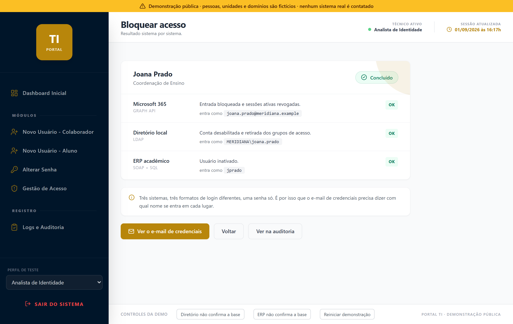

---

## Arquitetura

Cada sistema implementa a mesma interface — `existe`, `criar`, `ativar`,
`desativar`, `redefinir_senha` — e a orquestração não sabe falar com nenhum
sistema específico. Ela percorre providers e lê resultados.

```
portal_demo/
├── providers/
│   ├── base.py           a interface e a exceção de base não confirmada
│   ├── microsoft365.py   Graph API
│   ├── diretorio.py      LDAP
│   └── erp.py            SOAP + SQL
├── orquestracao.py       confirma todas as bases, depois escreve
├── politicas.py          escopo de perfil e proteção de alvo
├── auditoria.py          uma linha por ação, com filtro por categoria
└── credenciais.py        senha única e e-mail que explica onde ela vale
```

Acrescentar um quarto sistema é escrever mais um arquivo em `providers/`.
Nem a orquestração nem as telas mudam. Detalhes em
[docs/arquitetura.md](docs/arquitetura.md).

**Stack do portal real:** Flask 3, Jinja2, gunicorn · `msal` + Graph API ·
`ldap3` · SOAP sobre `requests` · `pymssql` · SQLite para auditoria · Tailwind
via CDN, sem framework de front-end. Cerca de 6.000 linhas de Python em 11
telas.

---

## Rodar a demonstração

```bash
python -m venv .venv && .venv/Scripts/activate   # Linux/macOS: source .venv/bin/activate
pip install -r requirements.txt
python app.py
```

Abra <http://127.0.0.1:5057>. A demonstração abre na tela de entrada, onde se
escolhe o perfil técnico. Não há nada para configurar: sem credenciais, sem
rede, sem banco externo.

Vale percorrer nesta ordem:

1. **Novo Usuário — Colaborador** e, no resultado, abrir o e-mail de credenciais
   — repare nos três formatos de login.
2. Em **Gestão de Acesso**, abrir *Tiago Vasconcelos* e tentar bloqueá-lo.
3. Trocar o perfil (canto inferior esquerdo) para **Operador de E-mail** e tentar
   chegar em `/criar-aluno` pela barra de endereços.
4. No rodapé, ligar **"Diretório não confirma a base"** e criar alguém.
5. Trocar o perfil para **Auditoria e Segurança** e ver o que ficou registrado
   nos passos 2, 3 e 4 — e que os outros perfis não veem.

As capturas deste README são geradas por [tools/capturas.py](tools/capturas.py),
que percorre esses mesmos fluxos com o Chrome em modo headless.

---

## Sobre os dados

Instituição, domínios, pessoas, unidades, cursos e identificadores desta
demonstração foram **inventados do zero para esta vitrine**. Nada foi copiado,
anonimizado ou borrado a partir de um ambiente real — inclusive porque campo
borrado em captura de tela costuma vazar pelo cabeçalho, pela barra de título ou
pelo rodapé aquilo que o corpo escondeu.

O domínio `.example` usado aqui é reservado pela [RFC 2606](https://www.rfc-editor.org/rfc/rfc2606)
justamente para exemplos e nunca resolve na internet.

**O que esta demo não tem:** as chamadas reais de rede, o mapeamento de cargos
para perfis de acesso, a configuração de ambientes e tudo que descreva a
topologia real. Nada disso é necessário para mostrar as decisões, e é
exatamente o que não deve estar num repositório público.
